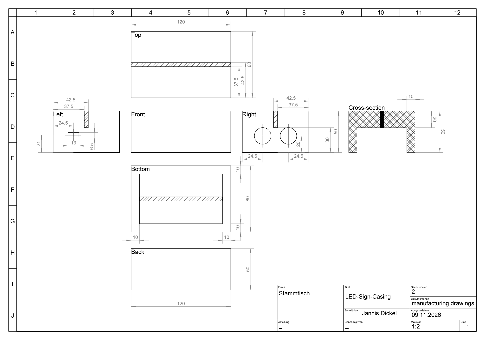

# LED SIGN – Raspberry Pi Pico W (MicroPython)

LED Sign is a Raspberry Pi Pico W project that

1. reads the distance to an object (ultrasonic sensor) and
2. changes the LED strip color based on that distance, 
3. and additionally exposes a small Web UI + REST API to control the LEDs.

## Hardware

- Raspberry Pi Pico W
- Individual addressable RGB LED strip (WS2812/NeoPixel compatible)
- Ultrasonic distance sensor (e.g. HC-SR04 compatible)

### Wiring circuit overview (schematic)

### Caseing drawings

### Building it

1. Build the Caseing

Begin by machining the wooden block. Saw and mill the workpiece according to the provided drawing and the specified dimensions.

After machining, it is recommended to sand all edges and surfaces to remove splinters and give the enclosure a clean finish.

2. Solder the Electronics

Once the enclosure is prepared, the electronics can be assembled. Solder all components together according to the circuit diagram. Connect the Raspberry Pi Pico, the LED strip, and the ultrasonic sensor following the specified pin assignments.

3. Install the Components

After successfully testing the electronics, they can be mounted inside the enclosure.

The LED strip is installed directly beneath the slot on the top side. Both hot glue and duct tape are suitable mounting options. It is important that the strip is positioned as centrally as possible beneath the slot so that the acrylic panel is illuminated evenly.

The Raspberry Pi Pico can be positioned using the designated opening for the USB cable. The USB-C connector serves as a practical mounting point, ensuring that the controller remains securely in place while still being easily accessible for programming and power supply. In most cases, no additional fastening is required, as the USB connection holds the Raspberry Pi very securely.

The sensor mounting holes are designed as a press fit. Therefore, the sensor can be inserted directly and will usually remain firmly in place without any additional fixation.

Finally, insert the acrylic panel into the designated groove.
Make sure that the motif or engraving is aligned in the desired orientation.

4. Customization

The project can easily be adapted to individual requirements. The sign size is not limited to the dimensions provided in this repository.

For example, the acrylic panel can also be installed in landscape orientation to allow for different layouts or larger lettering. Likewise, the dimensions of the entire project can be scaled as needed.

However, when increasing the size of the panel, the number of LEDs should also be increased accordingly to maintain uniform and sufficiently bright illumination. Depending on the size, a longer LED strip or a strip with a higher LED density may be required.

## Quick start

1. Flash MicroPython onto the Pico W.
2. Copy `settings.example.py` and rename it to`settings.py`.
3. **Important**: Edit `settings.py` and set your Wi-Fi and pins.
4. Upload the files to the Pico W and reboot it. This can be done in two ways:
   - Execute `py .\deploy.py -a -s -r -l`. This will copy all necessary files (including `settings.py`), reboot the 
     Pico W and start reading the serial output.
   - Copy the necessary files manually to the Pico W and reboot it.
5. The IP-address given to the Pico W will be printed on the serial console.

### How `deploy.py` works

`deploy.py` is a helper script to copy the necessary files to the Pico W and optionally reboot and read logs. 

It supports the following flags:

- `-h` to show the help message  
- `-p port` to specify the serial port (e.g. `COM3`, standard: auto-detect)
- `-a` to copy all necessary files
- `-f filename filename2` to copy the given files
- `-d dirname dirname2` to copy the given directories
- `-s` to copy `settings.py`
- `-r` to reboot the Pico W after deployment
- `-l` to start reading the serial output (logs) after deployment

## Features

You can change the colors of the LED strip through two different HMIs:

1. Web UI at `http://<pico-ip>/`
2. Ultrasound sensor

### Ultrasound Sensor – Distance color mapping

The measured distance (cm) of the ultrasound sensor maps to different colors:

- `< 3` blink + OFF
- `3..6` RED
- `6..9` ORANGE
- `9..12` YELLOW
- `12..15` GREEN
- `15..18` BLUE
- `18..21` PURPLE

### Web UI

After the Pico is connected to Wi-Fi, open:

- `http://<pico-ip>/`

The UI offers:

- RGB color picker
- OFF button
- __Effects__: Breath, Cycle, Lottery, Candy Tornado

Note: Any change of color, which is made either through the Web UI or the ultrasound sensor, cancels the currently running LED animation task (effect).

## How the project works

- On boot (`boot.py`) the Pico tries to connect to Wi-Fi and prints the assigned IP
  - If Wi-Fi is not available, it keeps retrying asynchronically
  - The ultrasound sensor will still be available
- Also on boot, the homepage with the current version is generated:
  - `lib/static/index.html` contains a `{{VERSION}}` placeholder
  - `boot.py` replaces it with the version from `pyproject.toml`
  - output is written to `lib/generated/index_with_version.html`
- In `main.py` the ultrasonic distance loop starts and updates the LEDs continuously based on the measured distance
- The web server is started on port **80** (if a Wi-Fi connection is available)

## Static IP recommendation

For a smoother experience, reserve a static lease for the Pico in your router/DHCP settings
(recommended) or implement a fixed IP configuration in MicroPython.

## Troubleshooting

- **Web UI shows 404 / blank page**: ensure `boot.py` ran and created
  `lib/generated/index_with_version.html` and that `lib/static/` exists.
- **Cannot connect to Wi-Fi**: re-check `SSID`/`Password` in `settings.py`. The device prints connection
  attempts and errors on the serial console.
- **Webserver not reachable**: verify the printed IP and that your client is in the same network.
  Server runs on port **80**.
- **LEDs stay off**: verify `NumLEDs`, `LEDPin`, power supply and LED type.
- **Distance colors keep updating**: the distance loop runs continuously. Verify that the ultrasound sensor points into 
  a direction that has no object in its way (at least 25 cm).

## Contributing / Support

- Feature request: contact one of the collaborators
- Bug report: open an issue or contact [SirDaywalker](https://github.com/SirDaywalker)

## License

[MIT](LICENSE)
